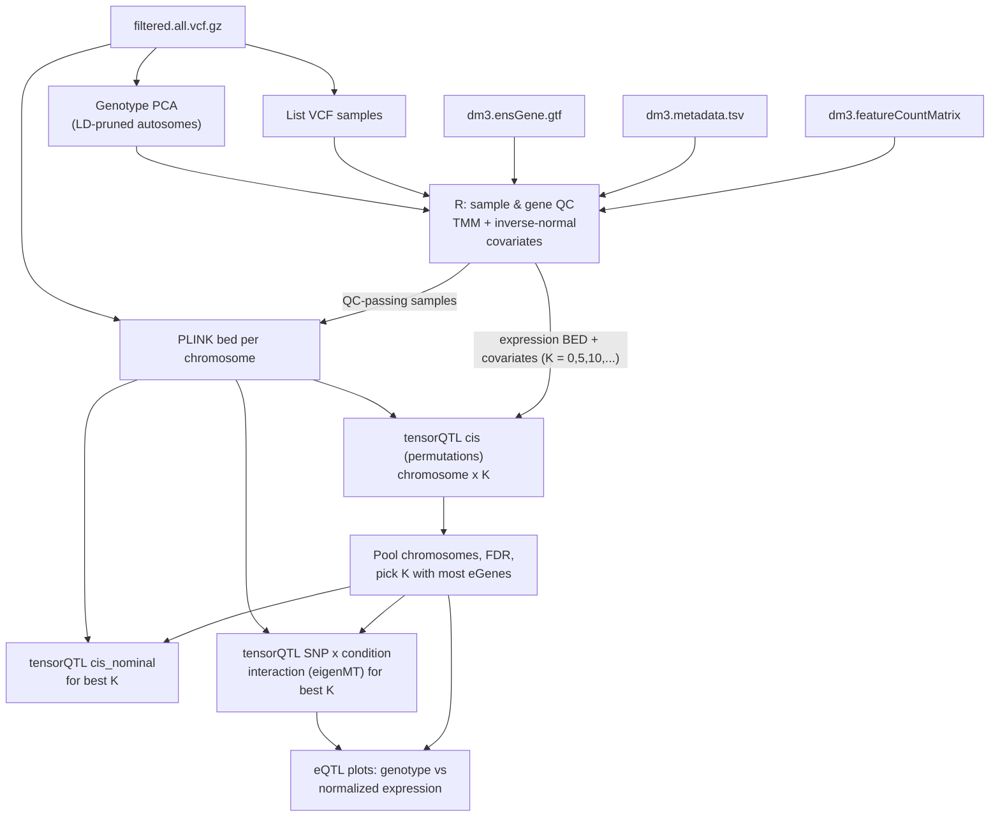

# nf-fly-eqtls: cis-eQTL mapping in *Drosophila* with tensorQTL


A Nextflow DSL2 pipeline for cis-eQTL mapping of single-fly RNA-seq and WGS from a desiccation-tolerance cage experiment (dm3). It is a simplified version of [nf-eqtls](https://github.com/connor122721/nf-eqtls): the sQTL/LeafCutter, kinship, coloc, and TOPMed-specific modules are gone. What's left goes from genotypes and counts to tensorQTL cis-eQTLs on the main chromosomes (2L, 2R, 3L, 3R, X).

## Pipeline



### Expression QC and normalization (`scripts/prep_expression.R`)

1. Keeps the samples that appear in the count matrix, the metadata, and the VCF. Every drop is logged.
2. **Sample QC:** drops samples more than `lib_mad` MADs below the median log10 library size or median number of detected genes. It then drops expression-PCA outliers: Mahalanobis distance on PCs 1–5, Bonferroni p < `pca_outlier_p`.
3. **Gene QC (GTEx-style):** keeps genes with CPM ≥ `cpm_threshold` and counts ≥ `count_threshold` in ≥ `sample_frac` of samples.
4. **Normalization:** edgeR TMM, then log2 CPM, then a rank-based inverse normal transform per gene (`norm_method = "int"`). Use `"logcpm"` to skip the transform.
5. **Phenotype BED:** one TSS per gene (the most upstream transcript start, strand-aware) from the GTF. The `chr` prefix is stripped automatically to match the VCF (`chr2L` → `2L`). Only genes on the chromosomes listed in `chromosomes` are kept.
6. **Covariates:** `model.matrix(covariate_formula)`, by default `~ cage_name + condition`, with `cage_name` and `condition` treated as factors. Optional extras are `n_geno_pcs` genotype PCs and K expression PCs. The expression PCs are computed on the residuals left after regressing out the known covariates, so they don't just rediscover condition/cage. Aliased columns (e.g. cage nested within condition) are detected and dropped with a warning. One covariate file is written per K in `expr_pcs`.

QC outputs: `fly.sample_qc.tsv`, `fly.expression_qc.pdf` (library size, PCA by condition/cage, residual PCA, scree, per-gene R² of the known covariates), and `prep_expression.log`.

### Genotypes (`modules/genotypes.nf`)

- plink2 reads the VCF with `--vcf-half-call missing`, because the VCF contains half calls such as `./0` and `1/.`. It keeps biallelic ACGT SNPs and applies `--geno` (`geno_missing`) and `--maf` filters. Variant IDs are set to `CHR:POS`.
- All samples are set to diploid on X (`--update-sex` as female) so plink2 does not apply haploid handling to unknown-sex flies.
- Genotype PCA runs on LD-pruned autosomal SNPs (`--indep-pairwise 50 5 0.2`), with `pca_geno` and `pca_maf` filters.

### QTL mapping (`modules/tensorqtl.nf`, `scripts/summarize_cis.R`)

- `expr_pcs` sets which numbers of expression PCs (K) are tried. It accepts a list and/or `from:to:by` ranges. The default `0:100:5` gives 21 models. The eGene-by-K curve is in `summary/fly.egenes_by_K.pdf`.
- tensorQTL `cis` runs per chromosome × K, using `cis_window` around the TSS (default ±100 kb) and `permutations`.
- The summary step pools all chromosomes for each K, applies BH FDR to `pval_beta`, and counts eGenes. It picks the K with the most eGenes (ties go to fewer PCs) and writes `fly.cis_eqtl.K<best>.all_chroms.txt.gz`.
- tensorQTL `cis_nominal` then runs for that K and writes parquet files per chromosome. You can force a K with `--best_k 10`; it must be one of the values in `expr_pcs`.

### SNP × condition interaction model

For each gene, the interaction run tests every cis SNP with:

```
expression ~ SNP + condition + SNP×condition + cage + expression PCs (best K)
```

This uses tensorQTL `cis_nominal --interaction` with `--best_only`. Settings:

- `interaction = "condition"`. It must be a 2-level metadata column. `prep_expression.log` reports which level is coded 0 and which is 1. A positive `b_gi` means the SNP effect is stronger in the level coded 1.
- tensorQTL regresses the interaction variable on the covariates. So the interaction run uses `fly.covariates_int.K*.txt`, which are the same covariates minus `condition`. The expression PCs are still computed after removing condition and cage.
- Each gene's lead interaction SNP is corrected for the number of tests within the gene using eigenMT (`pval_emt`). BH FDR is then applied across all genes on all chromosomes (`fdr_gi`). Results go to `summary/fly.interaction.top_assoc.all_chroms.txt.gz`.
- `maf_threshold_interaction` sets the MAF a SNP must have within each condition. Set `interaction_all_pairs = true` to also write every SNP-gene pair to parquet.
- Set `--interaction false` to skip this run.

### Gene symbols

`gene_annotation` points at FlyBase's `fbgn_annotation_ID_fb_*.tsv.gz`. It is used to add `gene_symbol` and `annotation_ID` (CG number) to every results table and plot.

- FBgns from the dm3 annotation that FlyBase has since merged or renamed are resolved through the secondary-FBgn column. The map's `match` column says `primary`, `secondary` or `unmapped`.
- Unmapped genes keep their FBgn as the label.
- The default is a URL that Nextflow downloads. If your cluster can't reach FlyBase, download the file once and point the parameter at the local copy. Use `--gene_annotation false` to skip symbols.

### Expression diagnostics

`expression/diagnostics/fly.expression_diagnostics.pdf` is a multi-page check that the expression data are ready for mapping:

| Area | Plots |
|---|---|
| Sample QC | library size and detected genes per cage×condition group; Mahalanobis outlier test; QC outcome per group (`fly.qc_by_group.tsv`) |
| Normalization | TMM factors per group; per-sample logCPM densities before and after TMM; relative log expression (RLE) per sample |
| Gene filter | mean-expression histogram of kept vs. removed genes; mean–variance trend; tested genes per chromosome |
| Sample structure | sample–sample correlation heatmap ordered by group; per-sample mean correlation; expression PCs 1–6 colored by cage, condition and library size |
| Covariates | R² heatmap of expression PCs vs. cage, condition, library size, detected genes and genotype PCs, both before and after covariate removal (`fly.pc_covariate_r2.tsv`) |
| Residual PCs | scree plus cumulative variance for PCs 1–100; residual PC1/PC2 colored by cage and condition |
| Per-gene variance | R² explained by cage, by condition and by the full model; top responsive genes with symbols (`fly.top_genes_by_covariate.tsv`) |
| Genotypes | genotype PCA colored by cage and condition |

### Manhattan and QQ plots

`plots/fly.manhattan_qq.pdf` contains:

- **SNP-level Manhattan** from the nominal pass at the best K. Each SNP gets its smallest p-value across genes. SNPs with p < `manhattan_keep_p` are all kept; a random `manhattan_thin_frac` of the rest are drawn. Lead SNPs of eGenes are shown in red.
- **Gene-level Manhattans:** one point per gene at its lead SNP, for the main model and for the interaction model. Significant genes are red, and the top `n_label` genes are labeled by symbol.
- **QQ plots** with λ for the main model (`pval_beta`) and the interaction model (`pval_emt`).
- **Summaries:** significant genes per chromosome, lead-SNP distance to the TSS, effect sizes, and lead-SNP MAF.

### eQTL plots

These cover the top `n_plot` eGenes from the main model (lead SNP per gene) and the top `n_plot` genes from the interaction model.

- Each page has two panels. Both plot expression (y) against genotype (x, e.g. `AA`/`AG`/`GG`, with n per class).
  - Left: normalized expression, which is what tensorQTL receives.
  - Right: expression with the model covariates regressed out. For main-model pairs that means cage, condition and the expression PCs. Interaction pairs use the interaction covariates, so the condition main effect stays visible.
- Titles show the gene symbol and FBgn.
- Main-model plots are colored by `plot_group`. Interaction plots split the boxes by condition and draw median lines per condition.
- Output: `plots/fly.eqtl_plots.main.pdf` and `plots/fly.eqtl_plots.interaction.pdf`.

## Usage

```bash
cd /project/berglandlab/connor/fly_QTLs_2026
git clone https://github.com/connor122721/nf-fly-eqtls.git

module load nextflow apptainer
nextflow run nf-fly-eqtls/main.nf -profile slurm -resume \
    --out /scratch/$USER/fly_eqtl/output

# Example overrides
nextflow run nf-fly-eqtls/main.nf -profile slurm -resume \
    --covariate_formula "~ cage_name + condition" \
    --n_geno_pcs 3 \
    --expr_pcs "0,5,10,15,20,30" \
    --cis_window 1000000
```

All parameters and their defaults are in `nextflow.config`.

### Inputs

| param | file | notes |
|---|---|---|
| `counts` | `dm3.featureCountMatrix.fixedNames` | first column gene ID (FBgn); featureCounts `Chr/Start/End/Strand/Length` columns are dropped if present |
| `metadata` | `dm3.metadata.tsv` | `sample`, `cage_name`, `fly_number`, `condition`; sample ID must be the first column |
| `vcf` | `filtered.all.vcf.gz` (+ `.tbi`) | chromosome names `2L`, `2R`, ... |
| `gtf` | `dm3.ensGene.gtf` | `gene_id` must match the count matrix |
| `chrom_file` | `chromosomes` | `2L 2R 3L 3R X` |

### Containers

| param | contents |
|---|---|
| `container_wgs` | bcftools, plink2 (`library://connmurr243/wgs/wgs_common`) |
| `container_tensorqtl` | tensorQTL, pandas_plink (`definition/fly_tensorqtl_python.def`, same as the TOPCHeF image) |
| `container_r` | R + edgeR, data.table, ggplot2, argparse (`definition/fly_eqtl_r.def`) |

The R image is new. Build and push it once before the first run:

```bash
apptainer build fly_eqtl_r.sif definition/fly_eqtl_r.def
apptainer push fly_eqtl_r.sif library://connmurr243/wgs/fly_eqtl_r.sif:latest
# or point params.container_r at the local .sif path
```

### Outputs (`params.out`)

```
genotypes/        vcf_samples.txt, fly.geno_pca.eigenvec, bed/fly.<chr>.{bed,bim,fam}
expression/       fly.expression.bed, fly.covariates.K*.txt, fly.samples.txt, QC tables + PDF
tensorqtl_cis/    fly.chr<chr>.K<k>.cis_qtl.txt.gz
summary/          fly.egenes_by_K.{tsv,pdf}, best_k, fly.cis_eqtl.K<best>.all_chroms.txt.gz, fly.egenes.K<best>.fdr0.05.tsv
tensorqtl_nominal/ fly.chr<chr>.K<best>.cis_qtl_pairs.<chr>.parquet
tensorqtl_interaction/ fly.chr<chr>.K<best>.interaction.cis_qtl_top_assoc.txt.gz
summary/          fly.interaction.top_assoc.all_chroms.txt.gz, fly.interaction.sig_genes.fdr0.05.tsv,
                  fly.nominal_snp_min_p.txt.gz, fly.plot_pairs.tsv
expression/       fly.fbgn_to_symbol.tsv, diagnostics/fly.expression_diagnostics.pdf (+ tables)
plots/            fly.eqtl_plots.{main,interaction}.pdf, fly.manhattan_qq.pdf
```

## Notes

- **Cage vs condition:** if each cage appears in only one condition, `condition` is aliased with `cage_name` and is dropped automatically, with a warning in `prep_expression.log`. In that case cage absorbs the condition effect. Check the log to see which columns were kept.
- **Missingness:** tensorQTL mean-imputes missing genotypes. Tighten `geno_missing` if the low-coverage calls are noisy.
- **Cis window:** the default is ±100 kb, chosen because fly genes are compact and LD decays quickly. Increase it with `--cis_window` if you expect longer-range LD in the cage population.

## Citation

Derived from [connor122721/nf-eqtls](https://github.com/connor122721/nf-eqtls). Uses [tensorQTL](https://github.com/broadinstitute/tensorqtl) (Taylor-Weiner et al. 2019, *Genome Biology*), [edgeR](https://bioconductor.org/packages/edgeR), and [PLINK 2](https://www.cog-genomics.org/plink/2.0/).
